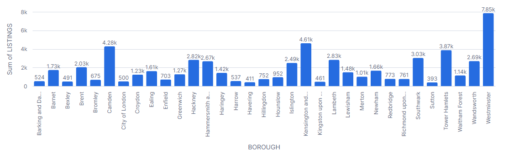
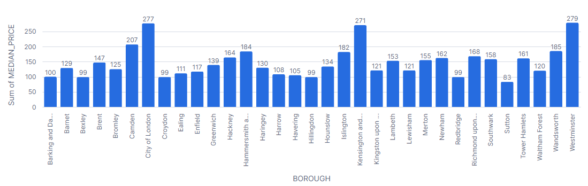
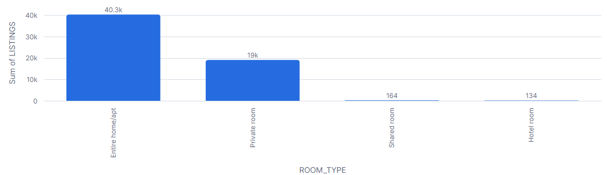
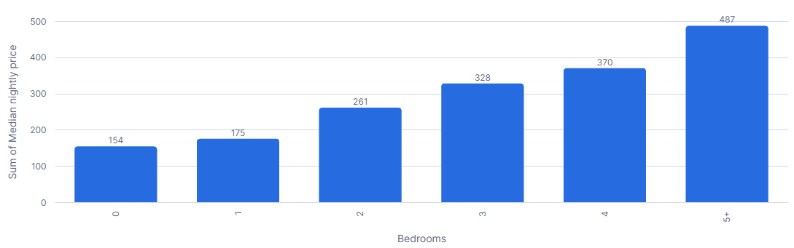

# London Airbnb Pricing Analysis with Snowflake and SQL

An end-to-end analytics project: clean a public Airbnb dataset, load it from **Amazon S3** into **Snowflake**, and use SQL to understand what drives nightly prices across London.

*Tools:* Snowflake (storage integration, external stage, `COPY INTO`, views), Amazon S3 and IAM, SQL (CTEs, window functions, `QUALIFY`), Excel Power Query.

---

## Business question

What drives the nightly price of an Airbnb listing in London, and how reliable is the data used to answer that?

## Data

- **Source:** [Inside Airbnb](https://insideairbnb.com/get-the-data) London detailed listings snapshot.
- **Size:** 91,954 listings.
- **Not included in this repo.** Download the data from the source above.

## Architecture

```
Inside Airbnb CSV
   -> cleaned in Excel (Power Query)
   -> uploaded to Amazon S3 (private bucket)
   -> Snowflake storage integration (IAM role, no stored keys) + external stage
   -> COPY INTO  AIRBNB_DB.RAW.listings_raw
   -> view       AIRBNB_DB.ANALYTICS.listings_clean
   -> SQL analysis and charts
```
## Data preparation

Done in Power Query before loading:

Cleaned in Excel with Power Query before loading:

1. Kept only the analysis columns (Home, Choose Columns) and dropped free-text and host-name fields.
2. Converted price to a number: removed the $ and , characters with Replace Values, then set the type to Decimal Number.
3. Converted the other numeric columns (reviews, bedrooms, availability, ratings) to numbers; values such as N/A were replaced with blanks.
4. Standardised dates to yyyy-MM-dd text so they load cleanly into Snowflake.
5. Removed duplicate listings by id.
6. Kept id and host_id as text, because the IDs are longer than the 15 digits Excel can store accurately as numbers.
7. Dropped columns that were completely empty in this snapshot: host_since, host_response_time, host_response_rate, host_acceptance_rate, instant_bookable.
8. Loaded the result to a sheet and saved it as CSV (UTF-8).

In Snowflake, `listings_clean` adds a `price_flag` (`ok`, `missing`, `too_low`, `too_high`) and a `host_type` grouping based on how many listings each host has.

## Data quality findings

| Check | Result |
|---|---|
| Rows loaded / unique IDs | 91,954 / 91,954 (no duplicates) |
| Listings with no price | 32,049 (about 35%) |
| Price distribution | median 175, 25th percentile about 100, 75th about 280, 99th about 1,272, maximum 75,000 |
| Outlier rule | Prices above 2,000 excluded (above the 99th percentile) |
| Listings analysed | 59,635 (about 65%) |

**Missing prices follow availability.** Of listings with no available nights in the next year (28,282), 98.9% have no price, compared with 6.4% of listings that have availability (63,672). Price results therefore describe **currently bookable listings**, not the whole market.

## Key findings

All prices are median nightly prices for listings with a price of 10 to 2,000.

1. **Location sets the price.** Westminster (279), City of London (277) and Kensington and Chelsea (271) are the most expensive, then a drop to Camden (207). Sutton is cheapest at 83, so the highest borough is about 3.4x the lowest.
2. **Room type matters most.** Entire homes are 67.6% of listings with a median of 226, about 2.8x a private room (80). Hotel and shared rooms are too few to compare.
3. **Rankings change by room type.** Wandsworth is in the top five for entire homes (250) but not for private rooms. City of London tops private rooms (180), but on only 62 listings.
4. **A third of listings are commercial-scale.** Hosts with 10 or more listings run 30.4% of priced listings and have a median of 222, versus 155 to 156 for other hosts. Part of this gap probably reflects room type and location.
5. **Space is rewarded unevenly.** Median price rises from 154 (studio) to 175 (1 bedroom), 261 (2), 328 (3), 370 (4) and 487 (5+). The biggest step is one to two bedrooms (+49%).
6. **Outer boroughs offer cheaper stays per guest.** Among well-reviewed listings, Havering (37.5), Bromley (39.4) and Lewisham (41.3) have the lowest median price per guest. Average ratings only range from 4.79 to 4.84 across the top ten, so ratings do not separate boroughs well.
7. **Many listings look dormant.** Across all listings, about 31% have no available nights and about 49% have had no review in the past 12 months. Hackney has the highest share without availability (46.8%).

## Visuals

## Visuals


*Number of priced listings analysed per borough, the sample size behind each median.*


*Median nightly price per borough (listings priced 10 to 2,000; boroughs with at least 100 priced listings).*


*Priced listings by room type: entire homes (67.6%) and private rooms (31.9%) dominate; hotel and shared rooms are too few to compare.*


*Median nightly price by bedrooms for entire homes (5+ means five or more).*

## Limitations

- Results describe listings with a price, which are mostly bookable listings; fully booked listings are excluded, so findings may not represent the whole market.
- These are associations, not causes. Group differences (for example host type) are not adjusted for room type or location.
- The snapshot is a single point in time, so there is no trend analysis.
- Host response fields were empty in this snapshot, so host-behaviour analysis was left out.
- "No availability" can mean fully booked or blocked, so it only approximates inactivity.
- Hotel rooms, shared rooms and some boroughs have small samples.

## Repository contents

| File | Purpose |
|---|---|
| `airbnb_s3_load.sql` | Creates the database, schema and table; sets up the S3 integration and stage; loads the data |
| `airbnb_analysis.sql` | Profiling, `listings_clean` view and the analysis queries |
| `screenshots/` | Query results and charts |

## How to reproduce

1. Download the London detailed `listings` file from Inside Airbnb and unzip it.
2. Run the Power Query script in Excel and save the output as `listings_slim.csv`.
3. Create a private S3 bucket with an `airbnb/` folder, upload the CSV, and create a read-only IAM policy and role for that folder.
4. Run `airbnb_s3_load.sql` in Snowflake replacing the placeholders (AWS account ID, role name, bucket) and updating the role's trust policy with the values from `DESC INTEGRATION`.
5. Run `airbnb_analysis.sql` section by section.
